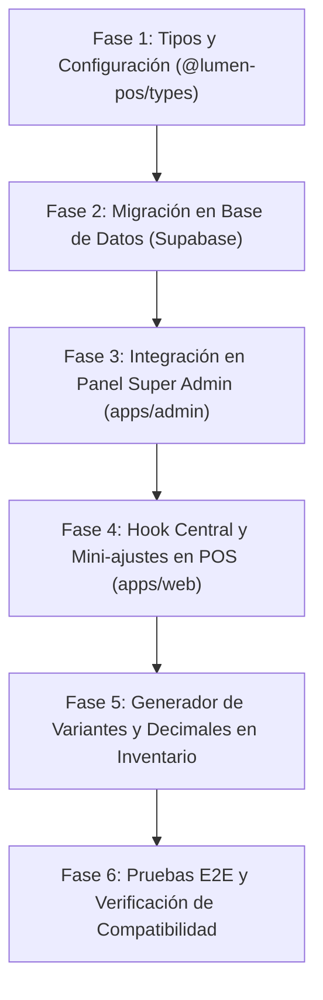

# Plan de Consolidación — Retail / Mostrador con Sub-rubros Especializados y Mini-ajustes

Este documento define la arquitectura técnica, las especificaciones funcionales y el plan de implementación paso a paso para consolidar el **Rubro Retail / Venta de Mostrador** en Lumen POS.

---

## 1. Visión y Objetivos

El objetivo principal es permitir que cualquier comercio del sector retail (desde una ferretería hasta una zapatería o un minimarket) sienta que el POS fue hecho a su medida, sin romper el núcleo común del sistema ni complicar la base de datos.

### Principios Fundamentales:
1. **Cero pérdida o alteración de datos existentes:**  
   La tienda actual (`Mi Tienda de Prueba`), sus 112 productos, variantes, movimientos de stock, ventas históricas y turnos de caja quedan **100% intactos**.
2. **Compatibilidad hacia atrás (Backward Compatibility):**  
   Cualquier tienda existente o que no especifique sub-rubro asume automáticamente **`comercio_general`**, funcionando exactamente igual que hoy.
3. **Sin categorías ficticias o precargadas:**  
   El inventario siempre arranca limpio. Cada comercio crea y organiza únicamente sus categorías reales.
4. **Control desde el Panel de Super Admin (`apps/admin`):**  
   Al dar de alta una nueva tienda (o editar una existente), el Administrador puede definir el rubro principal y su **Sub-rubro de Retail**.
5. **Flexibilidad total para el comerciante:**  
   El sub-rubro solo activa "atajos y comodidades recomendadas". Si el dueño quiere activar funciones de otros sub-rubros (por ejemplo, vender por metros en una zapatería), podrá hacerlo libremente desde Configuración.

---

## 2. Catálogo Oficial de Sub-rubros (7 Verticals de Retail)

| Código | Nombre del Sub-rubro | Descripción del Negocio |
| :--- | :--- | :--- |
| `comercio_general` | **Comercio General / Estándar** | Negocios de mostrador genéricos (baseline actual del sistema). |
| `minimarket_abarrotes` | **Minimarket, Abarrotes y Licorería** | Tiendas de barrio, bodegas, autoservicios y distribuidoras de bebidas. |
| `ropa_calzado` | **Tienda de Ropa, Calzado y Moda** | Boutiques, zapaterías, indumentaria, carteras y accesorios de vestir. |
| `ferreteria_construccion`| **Ferretería, Pinturería y Materiales** | Ferreterías, repuestos, corralones, electricidad y pinturas. |
| `farmacia_belleza` | **Farmacia, Cosmética y Cuidado Personal**| Boticas, perfumerías, suplementos y productos estéticos. |
| `libreria_papeleria` | **Librería, Papelería y Bazar** | Papelerías, artículos escolares/oficina, impresiones y regalos. |
| `tecnologia_celulares` | **Tecnología, Celulares y Accesorios** | Venta de smartphones, periféricos, cables, consolas y reparaciones. |

---

## 3. Matriz de Características: Lo Compartido vs. Lo Especial

### A. Lo que COMPARTEN todos (El Núcleo Común)
* **Base de datos unificada:** Mismas tablas de `stores`, `users`, `products`, `product_variants`, `sales`, `sale_items`, `cash_registers` y `cash_movements`.
* **Arqueos de Caja por Turnos:** Apertura de caja, ingresos, retiros/gastos con motivo, conteo ciego de billetes y cálculo de sobrante/faltante.
* **Múltiples Métodos de Cobro:** Efectivo, Tarjeta, QR, Transferencia bancaria y pagos combinados (*Split*).
* **Venta con Stock Negativo Tolerado:** Alertas visuales amigables y reconciliación automática de inventario sin trabar la fila de venta.
* **Operatividad Offline:** Venta sin conexión a internet mediante cola local en IndexedDB y autosincronización al volver la red.
* **Seguridad y Permisos:** Control granular por roles (Dueño, Administrador/Encargado, Cajero).
* **Reportes y Analíticas:** Métricas de facturación, ticket promedio, margen de ganancia real y productos más vendidos.

---

### B. Especificaciones Especiales por Sub-rubro (Las Mini-Ajustaciones)

#### 1. 🛒 Minimarket, Abarrotes y Licorería (`minimarket_abarrotes`)
* **Enfoque en POS:** Modo de escaneo continuo (el foco del teclado siempre vuelve automáticamente al campo de código de barras tras cada escaneo).
* **Calculadora de Vuelto Rápido:** Botones táctiles de billetes comunes (`Bs 10`, `Bs 20`, `Bs 50`, `Bs 100`, `Bs 200`) en el modal de cobro en efectivo para calcular el cambio en 1 clic.
* **Unidades de Medida Permitidas:** Unidad (`u`), Kilogramo (`kg`), Litro (`L`), Paquete (`paq`).
* **Ticket:** Formato ultra compacto optimizado para consumo rápido y ahorro de papel térmico.

#### 2. 👗 Tienda de Ropa, Calzado y Moda (`ropa_calzado`)
* **Matriz de Variantes en Lote (Creación rápida):**  
  Al registrar un producto, el usuario selecciona Tallas (`35, 36, 37, 38...` o `XS, S, M, L, XL`) y Colores (`Negro, Blanco, Azul...`) y el sistema genera todas las combinaciones automáticamente.
* **Selector Visual en POS:** La tarjeta del producto muestra chips de tallas disponibles con su stock correspondiente para añadir al carrito en un toque sin abrir modales pesados.
* **Unidades de Medida Permitidas:** Unidad (`u`), Par (`par`).
* **Pie de Ticket por Defecto:**  
  *"Plazo para cambios: 15 días con este comprobante y la prenda con etiqueta original intacta. No se realizan devoluciones de dinero."*

#### 3. 🔧 Ferretería, Pinturería y Materiales (`ferreteria_construccion`)
* **Venta Fraccionada con Decimales:** Habilita el ingreso de cantidades no enteras en el carrito de compras (ej. `2.5` metros de cable, `0.75` kg de clavos, `1.5` litros de solvente).
* **Búsqueda por Código de Fabricante / Marca:** La barra de búsqueda prioriza el campo `brand` y el código del proveedor además del nombre genérico del artículo.
* **Unidades de Medida Permitidas:** Metro (`m`), Centímetro (`cm`), Kilogramo (`kg`), Litro (`L`), Galón (`gal`), Unidad (`u`), Bolsa (`bolsa`).
* **Ticket:** Imprime la unidad de medida y la marca al lado de cada ítem cobrado.

#### 4. 💊 Farmacia, Cosmética y Cuidado Personal (`farmacia_belleza`)
* **Campos de Laboratorio / Marca:** Visualización destacada de la marca fabricante o laboratorio para diferenciar genéricos de marcas comerciales.
* **Venta Fraccionada Caja / Blíster:** Atajo en la creación de variantes para definir precio por caja cerrada o precio por pastilla/blíster individual.
* **Unidades de Medida Permitidas:** Unidad (`u`), Caja (`caja`), Blíster (`blíster`), Frasco (`frasco`).
* **Pie de Ticket:** Leyenda sanitaria (*"Verifique su medicación antes de retirarse. Los medicamentos no admiten cambios ni devoluciones por normativas de salud"*).

#### 5. 📚 Librería, Papelería y Bazar (`libreria_papeleria`)
* **Botones de Venta Rápida "Al Vuelo":** Panel en pantalla para registrar servicios frecuentes sin código de barras (*Fotocopia B/N, Fotocopia Color, Anillado, Plastificado, Escaneo*), pidiendo solo cantidad y monto.
* **Unidades de Medida Permitidas:** Unidad (`u`), Hoja (`hoja`), Resma (`resma`), Paquete (`paq`).
* **Ticket:** Detalle ágil agrupando productos y servicios.

#### 6. 📱 Tecnología, Celulares y Accesorios (`tecnologia_celulares`)
* **Registro Opcional de Número de Serie / IMEI:** Al cobrar un producto marcado como electrónico, se habilita un campo opcional para capturar el serial o IMEI, guardándolo en `sale_items.notes`.
* **Cláusula de Garantía en Ticket:** El comprobante imprime el número de serie y la cláusula:  
  *"Garantía del equipo: 3 meses por desperfectos de fábrica presentando este comprobante original."*
* **Unidades de Medida Permitidas:** Unidad (`u`), Kit (`kit`).

#### 7. 🏷️ Comercio General (`comercio_general`)
* Configuración estándar y equilibrada sin preajustes forzados.

---

## 4. Arquitectura Técnica y Modelo de Datos

### 4.1 Base de Datos (PostgreSQL en Supabase)
Se añade una columna no destructiva a la tabla `stores`:

```sql
-- Agregar sub-rubro de retail a la tabla stores con default 'comercio_general'
ALTER TABLE public.stores 
ADD COLUMN IF NOT EXISTS industry_sub_type text NOT NULL DEFAULT 'comercio_general';

-- Constraint para asegurar que solo se guarden valores válidos
ALTER TABLE public.stores 
DROP CONSTRAINT IF EXISTS stores_industry_sub_type_check;

ALTER TABLE public.stores 
ADD CONSTRAINT stores_industry_sub_type_check 
CHECK (industry_sub_type IN (
  'comercio_general',
  'minimarket_abarrotes',
  'ropa_calzado',
  'ferreteria_construccion',
  'farmacia_belleza',
  'libreria_papeleria',
  'tecnologia_celulares'
));
```

### 4.2 Paquete de Tipos Compartido (`@lumen-pos/types`)
En `packages/types/src/business.ts`:
* Definición del tipo `RetailSubType`.
* Objeto de configuración `RETAIL_SUBTYPES: Record<RetailSubType, RetailSubrubroConfig>` con:
  * `code`: Identificador único.
  * `name`: Nombre descriptivo legible.
  * `icon`: Nombre de icono representativo.
  * `allowedUnits`: Lista de unidades de medida permitidas.
  * `allowDecimals`: Booleano para permitir ventas con decimales.
  * `quickCashButtons`: Array de números con billetes sugeridos para el vuelto.
  * `autoFocusBarcode`: Booleano para mantener foco continuo en lector de barras.
  * `hasSerialCapture`: Booleano para captura de número de serie/IMEI.
  * `hasQuickServices`: Booleano para botones de venta rápida al vuelo.
  * `defaultTicketPolicy`: Texto por defecto para el pie del ticket.

### 4.3 Panel de Super Admin (`apps/admin`)
* **Alta de Tienda (`CreateStoreForm.tsx`):**
  * Cuando `business_type === 'tienda_articulos'`, se muestra el selector de **Sub-rubro de Retail** con sus 7 opciones y descripción breve.
* **Edición de Tienda (`EditStoreModal.tsx`):**
  * Permite cambiar el sub-rubro de una tienda si el cliente modifica su actividad.
* **Tabla de Tiendas (`StoresTable.tsx`):**
  * Muestra un badge con el sub-rubro al lado del nombre de la tienda.

### 4.4 Aplicación Web del Negocio (`apps/web`)
* **Hook Central `useRetailSubrubro()`:**  
  Lee `industry_sub_type` de la tienda y expone las propiedades activas para condicionar la interfaz sin duplicar código.
* **Ajustes en Componentes:**
  * `ManualBarcodeInput.tsx`: Comportamiento de foco automático si `autoFocusBarcode: true`.
  * `CartDrawer.tsx` y `QuantityInput`: Permite `step="any"` o decimales si `allowDecimals: true`.
  * `CashPaymentModal`: Renderiza botones de billetes rápidos (`quickCashButtons`).
  * `TicketModal.tsx`: Utiliza `defaultTicketPolicy` en la vista previa e impresión del ticket.
  * `ProductCreateModal.tsx`: Generador de variantes por terna Talla/Color en un clic para tiendas de ropa/calzado.

---

## 5. Fases de Implementación



### Fase 1: Tipos y Configuración Declarativa
* Crear la definición de `RetailSubType` y `RETAIL_SUBTYPES` en `@lumen-pos/types`.
* Exportar utilidades de consulta: `getRetailSubrubroConfig(subType)`.

### Fase 2: Migración de Base de Datos
* Aplicar migración en Postgres para agregar columna `industry_sub_type` con valor por defecto `'comercio_general'`.
* Actualizar el servicio de creación y actualización de tiendas en el backend Supabase.

### Fase 3: Integración en Panel de Super Admin
* Modificar `CreateStoreForm.tsx` y `CreateStoreModal.tsx` para incluir el selector de sub-rubros.
* Modificar `EditStoreModal.tsx` para edición de sub-rubro.
* Modificar `StoresTable.tsx` para reflejar el sub-rubro en la lista de comercios.

### Fase 4: Hook y Mini-ajustes en el POS
* Implementar hook `useRetailSubrubro()` en `apps/web`.
* Agregar botones de vuelto rápido en el modal de cobro en efectivo.
* Añadir soporte de foco continuo para lectores de código de barras en Minimarkets.
* Adaptar pie de ticket con leyendas automáticas de cambio/garantía.

### Fase 5: Mejoras de Inventario para Ropa y Ferretería
* Añadir generador masivo de tallas/colores en el modal de creación de variantes.
* Habilitar cantidades decimales en el carrito y cobro para productos medibles (m, kg, L).

### Fase 6: Pruebas y Control de Calidad
* Validar que la tienda de prueba existente (`Mi Tienda de Prueba`) mantiene todos sus datos y opera como `comercio_general`.
* Crear tiendas de prueba con sub-rubros de *Ropa*, *Ferretería* y *Minimarket* desde el panel admin y verificar que cada una adopta sus mini-ajustes.
* Compilación limpia con `pnpm build` en todos los paquetes.
